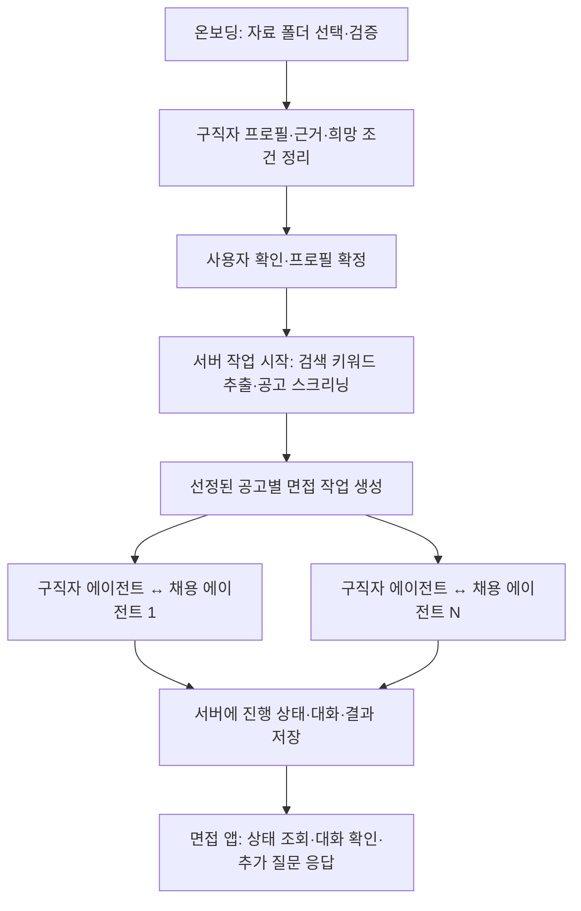

# 온보딩과 서버 기반 1:N 에이전트 면접 개발 계획

상태: 아래 내용은 전체 기능의 설계 제안이다. 면접 앱의 샘플 검색·1:N 대화·진행 조회를 먼저 구현했으며, 현재 동작과 제약은 [면접 앱 문서](../interviews/00_overview.md)를 기준으로 한다. 온보딩 연동·Supabase 저장·사용자 응답 재개는 아직 없다. 샘플 단계는 별도 DB 복제 없이 Workflow 저장 스트림을 조회하고, 공고별 대화를 한 workflow 안의 병렬 분기로 격리한다.

이해한 범위: 온보딩에서 자료를 확인해 구직자 에이전트를 준비하고, 그 에이전트가 추출한 검색 키워드로 공고를 스크리닝한다. 선택된 각 공고의 채용 에이전트와 독립적인 면접을 진행한다. 면접은 프론트엔드 상태와 무관하게 서버에서 계속 실행되고, 사용자는 진행 상태를 조회한다.

## 확정 사항과 현재 빈 부분

- 구직자 자료와 채용공고는 각각 `index.json`을 포함한 폴더로 제공된다. 앱 간 프로필은 `3533b97`에서 추가한 [프로필 데이터 계약 v1](../shared/00_profile_contract.md)에 맞춘다. 원문 상태는 제안이며 타입·테이블은 미구현이다. 실제 폴더 manifest와 채용공고 JSON 형식은 아직 없다.
- 실제 Claude 대화, 가상 구직자 1명, 샘플 기업·공고, 로그인 없는 데모라는 기존 범위를 유지한다.
- 1:N의 N은 실제로 검색·선택한 공고 수다. 모든 공고를 무조건 실행하거나 가상의 실행 수를 표시하지 않는다.
- 창 닫기·새로고침·앱 간 이동은 면접을 중단시키지 않는다. 명시적 취소·실행 제한·오류만 실행 종료 사유가 된다.
- 프로필 필드의 기준은 위 데이터 계약이며 이 계획에 별도 프로필 스키마를 정의하지 않는다. 폴더 배치, Workflow SDK 도입, 초기 실행 한도는 제안이다. 모델과 비용 한도는 구현 착수 시 확정한다.

## 전체 흐름과 앱의 책임



| 영역 | 구현 책임 |
| --- | --- |
| `apps/onboarding` | 자료 확인, 프로필과 희망 조건의 확인·수정, 확정 프로필 생성, 면접 시작과 면접 앱 이동 |
| `apps/interviews` | 서버의 검색·스크리닝·면접 실행, 실행·질문 응답 API, 진행 화면과 대화·결과 조회 |
| `packages/shared` | 검증된 입력·프로필·상태 타입, 두 앱이 사용하는 자료 로더, 기존 Supabase 클라이언트 |
| Supabase | 확정 프로필, 실행별 공고 스냅샷, 현재 상태, 대화와 결과 저장 |

온보딩 앱부터 구현하지만, 온보딩 앱 안에 면접 실행 엔진까지 넣지 않는다. 구직자의 조건 확인 인터뷰와 두 에이전트의 면접도 별도 대화로 관리한다.

## 1. 데이터 계약에 맞춰 자료 연결하기

초기에는 서버에 준비한 가상 자료 폴더를 읽는 방식을 제안한다. 브라우저에서 임의의 서버 경로를 받아 읽거나 외부 링크를 자동 수집하는 기능은 추가하지 않는다.

```text
data/demo/
  candidates/candidate-1/
    index.json
    public/experience.md
    public/strengths.md
    private/interview.md
  jobs/job-1/
    index.json
    description.md
  jobs/job-2/...
```

이는 제안 배치이며 현재 존재하는 데이터가 아니다. 추가된 계약은 앱 간 `PublicProfile`·`PrivateProfile`과 Markdown의 형식을 정의한다. `index.json`이 프로필 자체인지 별도 파일 목록인지, 비공개 JSON을 폴더 어디에 두는지는 아직 정의하지 않는다. 기존에 제안했던 `id`·`documents`만 있는 JSON 예시는 사용하지 않고 실제 입력과 계약 사이의 매핑을 먼저 확정한다. 공고의 기업명·직무명·요구사항·연봉 형식도 별도 입력 계약으로 정한다.

| 계약 요소 | 구현에 반영할 기준 |
| --- | --- |
| `PublicProfile` | `schemaVersion: 1`, `candidateId`, 요약·위치·언어·역량·경력·전환 강점·희망 조건과 공개 `docs` |
| `PrivateProfile` | 같은 `candidateId`, `salary`, `dealbreakers`, `mustEmphasize`, `openQuestions`, 비공개 `docs` |
| `ProfileDoc` | `path`, `about`, `visibility`; 공개·비공개 문서 목록을 섞지 않음 |
| `Evidence` | `source`, 선택적 `docPath`·`quote`; `docPath`의 제목 앵커도 유지 |
| `Skill.verified` | 제공된 자료로 확인한 경우만 true, 본인 주장만 있으면 false |

코드에서 조건 비교에 쓰는 값은 구조화된 JSON 필드에 두고, 긴 맥락은 Markdown에 둔다. 문서를 추가하면 해당 프로필의 `docs`에도 등록한다. 비공개 문서가 공개 프로필이나 공개 근거 경로를 통해 노출되지 않는지도 검증한다.

첫 파서는 Markdown·텍스트·JSON만 지원하는 안을 제안한다. PDF 등 추가 형식이 필요하면 샘플을 확인한 뒤 추출 방식을 정한다. 없는 자료를 읽은 것처럼 처리하거나 미지원 파일을 조용히 버리지 않는다.

JSON 오류, 중복 ID, 누락 문서, 지원하지 않는 형식, 파일·전체 입력 크기를 검증한다. 절대 경로·상위 폴더 이동·심볼릭 링크를 통한 자료 루트 이탈도 차단한다. 자료 안의 명령문은 에이전트 지시가 아니라 참고 데이터로 취급한다.

공개 Git 저장소에는 가상 샘플만 둔다. 나중에 실제 자료가 오면 비공개 저장 위치를 정하고, Vercel 실행 환경에서도 같은 입력을 읽을 수 있는지 별도로 확인한다.

## 2. 온보딩: 구직자 에이전트 준비

화면은 자료 확인 → 프로필·조건 확인 → 에이전트 준비 완료의 세 단계로 구성한다.

1. 제공된 폴더와 문서 목록을 표시하고 자료 읽기 결과를 확인한다.
2. Claude가 계약의 `PublicProfile`·`PrivateProfile`로 경력·역량·관심사·희망 조건을 정리한다. 자료에 없는 값은 `PrivateProfile.openQuestions`에 남긴다.
3. 사용자가 프로필과 협상 가능한 범위를 확인·수정한다. 자료에서 추출한 사실과 사용자가 입력한 희망을 구분한다.
4. 온보딩 실행마다 새 `candidate_id`를 발급한다. 사용자가 확인한 공개 프로필에 `confirmed_at`을 기록하고 공개·비공개 프로필과 문서를 일관되게 저장한 뒤 면접에 사용한다. “공고 검색 및 면접 시작” 연결은 3단계에서 구현한다.

필수 구조화 값이 비어 있으면 임의의 0이나 추정값으로 채우지 않고 초안으로 유지한다. 확정에 필요한 질문과 보류 가능한 질문을 구분한다. `schemaVersion`은 계약 버전이므로 사용자 응답이나 프로필 편집 때마다 올리지 않는다. 계약 필드를 바꾸는 경우에만 계약 문서의 변경 절차를 따른다.

구직자 에이전트는 별도 OS 프로세스가 아니라, 확정 프로필·행동 지침·조건 범위·근거 참조로 구성한 실행 설정이다. 모델은 존재하지 않는 경력이나 사용자의 수락 의사를 만들어낼 수 없다.

## 3. 구직자 에이전트의 키워드 추출과 공고 스크리닝

서버 작업의 첫 단계에서 `confirmed_at`이 있는 프로필의 `wants`, `transferableStrengths`, `skills`, `experience`를 사용해 직무·기술·도메인·관심사·전환 역량과 검색 동의어를 추출한다. 각 핵심 키워드의 근거를 `Evidence`와 연결한다. 검색 입력에 연봉 하한 등 비공개 협상 정보를 섞지 않는다.

샘플 공고의 제목·요구 역량·본문에서 키워드를 검색하고, 명시한 필수 조건과 조정 가능한 조건을 분리해 후보를 추린다. 첫 버전은 작은 공고 집합에 대한 키워드 검색과 명시적 조건 비교로 시작한다. 벡터 DB와 외부 채용 사이트 연동은 현재 필요하지 않다.

누락된 연봉이나 근무 조건을 불일치로 단정하지 않는다. 관련성, 근거와 확인할 조건을 보여주며, 명시적 필수 조건과 충돌한 공고는 그 이유를 남긴다. 검색 결과가 0개이면 정상적인 검색 완료 상태로 표시한다.

실행 대상으로 정한 상위 N개 공고의 스냅샷을 저장하고 공고별 면접을 생성한다. 초기에는 샘플 공고 3개·동시 실행 2개를 제안하며, 검색 후보 수·선정 수·실제 실행 수를 화면에서 구분한다.

## 4. 1:N 면접: 프로필은 공유하고 대화는 격리

모든 면접은 동일한 확정 프로필 스냅샷을 사용한다. 각 공고의 채용 에이전트는 해당 공고의 직무·요구사항·기업 조건과 `PublicProfile.summary`, 필요한 공개 문서만 입력으로 생성한다. 기업별 구직자 대화 이력과 채용자 대화 이력을 독립적으로 유지한다.

`PrivateProfile`과 private 문서는 구직자 에이전트 측만 읽는다. `salary.floor`는 조건 비교에만 사용하며 채용 에이전트 프롬프트·대화·공개 로그에 포함하지 않는다. `dealbreakers`, `mustEmphasize`, `openQuestions`도 계약의 역할 구분을 지킨다. 두 에이전트는 해당 면접에 공개한 발언과 필요한 공개 근거만 교환하며 다른 기업의 대화를 공유하지 않는다.

대화는 경험 확인 → 업무·근무 조건 확인 → 연봉 조건 협의 → 결과 정리로 진행하는 안이다. 연봉 정보나 조정 여지가 있어 실제 협의를 수행할 때만 “연봉 협상 중…”을 표시한다. 초기 한도는 왕복 3회와 별도 결과 정리 1회로 제안하되, 단계 생략과 사용자 확인 요청을 허용한다.

판단할 수 없는 조건은 사용자 확인 대기로 전환한다. 다른 기업의 면접은 계속 진행한다. 응답을 받으면 같은 면접의 저장된 단계에서 재개한다. 결과는 면접 추천·보류·조건 불일치이며 실제 기업의 채용 결정이나 외부 면접 초대를 의미하지 않는다.

## 5. 프론트엔드와 독립된 서버 실행

기존 Next.js 앱 안에서 Vercel Workflow SDK로 검색·면접 작업을 실행하는 안을 권장한다. 별도 세 번째 앱은 만들지 않는다. Route Handler는 작업을 등록하고 실행 ID를 반환하며, 실제 작업은 지속 실행 런타임이 담당한다.

검색·공고 선정은 상위 workflow, 공고별 면접은 독립된 하위 workflow로 구성한다. 실행 개수 제한과 실패 격리를 적용하고, 사용자 응답 대기는 지속 가능한 대기·재개 기능을 사용한다. 동시 실행 한도는 실제 Claude 호출에 적용하며, 사용자 응답을 기다리는 면접은 호출 슬롯을 점유하지 않는다.

Claude 호출, 자료 읽기와 DB 쓰기는 재시도 가능한 step으로 나눈다. 재시도 시 대화·결과가 중복 저장되지 않도록 실행·면접·턴 ID와 유일성 제약을 둔다. 장애 직전의 외부 API 호출은 재실행 비용이 발생할 수 있으므로 비용·호출 한도에 재시도도 포함하고, 무제한 재시도나 exactly-once 호출을 보장한다고 표현하지 않는다.

두 앱 간 시작 요청은 서버 경유로 전달한다. 내부 API 주소와 인증 값은 서버 환경변수로 관리하고 브라우저에 노출하지 않는다. 로그인 없는 샘플 데모라도 공개 실행 API에는 입력 검증, 요청 제한, 중복 시작 방지와 비용 상한이 필요하다.

실행 ID는 권한 증명이 아니다. 실행별 제어 토큰을 발급하고 서버에는 검증용 해시를 저장한다. 온보딩에서 면접 앱으로 이동할 때는 만료가 짧은 일회용 전달 코드를 교환해 면접 앱의 HttpOnly 쿠키를 설정하는 안을 제안한다. 영구 제어 토큰을 URL에 넣지 않으며, 조회·응답·취소 API는 해당 실행에 대한 권한을 검증한다. 이는 로그인 화면 없이 데모 실행 간 간섭을 막기 위한 최소 제어다.

화면은 실행 ID로 상태를 조회한다. 최초에는 짧은 주기의 HTTP polling으로 구현해 화면 갱신과 실행을 분리한다. 페이지를 닫으면 조회만 멈추며, 다시 열면 같은 실행의 저장된 상태를 읽는다. 전체 실행이 종료되면 polling을 멈춘다. Supabase Realtime과 WebSocket은 처음부터 도입하지 않는다.

면접 앱은 실행별 `/runs/{runId}` 주소로 진입한다. 같은 주소에 재접속하면 쿠키 권한을 확인하고 현재 상태를 복원한다. API 호출 전 동시 실행 슬롯을 획득하고 호출 종료·실패 시 반환하며, 작업 장애에 대비해 슬롯 임대 만료도 적용한다. 사용자 응답 대기는 슬롯 반환 후 수행하고 응답 후 다음 호출 때 다시 획득한다.

서버 메모리의 Promise, 프론트엔드 루프 또는 일반 HTTP 요청 하나가 전체 면접의 수명을 책임지는 구조는 사용하지 않는다. 로컬·Vercel의 workflow 실행 환경과 복구 동작을 먼저 검증한 뒤 채택한다. 지원되지 않으면 별도 worker가 대안이며, 조용히 브라우저 의존 방식으로 대체하지 않는다.

## 6. 진행 화면과 상태 계약

| 구분 | 값 또는 표시 |
| --- | --- |
| 실행 상태 | 대기, 실행 중, 사용자 응답 대기, 완료, 오류, 취소 |
| 진행 단계 | 자료 분석, 키워드 추출, 공고 검색, 경험 확인, 근무 조건 확인, 연봉 협의, 결과 정리 |
| 완료 결과 | 면접 추천, 보류, 조건 불일치 |

각 기업 카드에는 현재 단계, 마지막 갱신 시각, 대화 내역, 확인한 근거와 필요한 질문을 표시한다. 상단에는 전체 실행·완료·응답 대기·오류 건수를 보여준다. UI 타이머로 가짜 단계를 순환시키지 않고, 서버가 기록한 실제 단계 전환을 표시한다.

오류는 조건 불일치로 바꾸지 않는다. 한 기업의 실패가 전체 실행을 실패시키지 않으며, 나머지는 계속 진행하고 실패한 기업만 재시도할 수 있게 한다. 취소는 서버 작업과 진행 상태에 함께 반영한다.

실행 가능한 면접이 남아 있으면 전체는 실행 중이며, 남은 면접이 모두 사용자 응답을 기다리면 전체도 응답 대기다. 모든 면접이 종료되면 성공·오류 건수를 함께 표시한다. 일부 오류가 있어도 전체가 끝났음을 알리되 오류를 성공 건수에 포함하지 않는다.

## 7. 저장 구조와 구현 영향 범위

| 영역 | 추가 또는 변경할 내용 |
| --- | --- |
| onboarding 화면·서버 처리 | 자료 확인, 프로필 생성·수정·확정, 서버 실행 시작과 면접 앱 이동 |
| interviews 서버 | 검색·스크리닝 workflow, 공고별 면접 workflow, 진행 조회·응답·취소 API |
| interviews 화면 | 실행 목록·기업별 카드·대화 상세·사용자 응답 |
| shared | v1의 `Evidence`·`Skill`·`Experience`·`ProfileDoc`·`PublicProfile`·`PrivateProfile` 타입, 입력 검증·상태 계약·서버 전용 로더와 명시적 export |
| DB | 계약의 `candidate_public`·`candidate_private`·`candidate_docs`를 따르고 검색 실행·공고별 면접·메시지·결과를 추가; RLS·유일성 제약·접근 제어 |
| 설정·문서·테스트 | 서버 비밀 키와 실행 설정 예시, Workflow의 Next.js 설정, 재현 가능한 샘플과 검사, 앱별 문서 |

프로필과 공고는 실행 시점의 스냅샷을 사용한다. 나중에 폴더나 희망 조건이 바뀌어도 진행 중인 면접의 입력이 달라지지 않는다. Workflow의 실행 기록은 복구 기준이고, Supabase의 상태는 화면 조회용으로 관리한다. 재시도·중단 시 두 상태를 대조하고 동기화하는 경로를 둔다.

공개 프로필과 비공개 프로필은 별도 테이블로 관리한다. 문서는 `candidate_docs.visibility`에 따라 읽는 역할을 제한한다. 확정 프로필·비공개 조건·문서의 일관된 저장과 실행 시 스냅샷 생성 방법은 테이블 구현 시 정한다. 전달하는 URL에는 프로필 내용이나 연봉·비공개 문서를 넣지 않으며, `candidate_id` 자체를 권한 증명으로 취급하지 않는다.

## 개발 순서와 단계별 완료 기준

1. **자료 계약과 샘플**: v1 타입·검증과 폴더 매핑을 정의하고, 가상 구직자 1명·공고 3개 작성. 근거·공개 범위·경로 이탈·파싱 오류를 검증.
2. **온보딩 구현**: 실제 Claude로 공개·비공개 프로필을 생성하고, 사용자 확인 후 새 `candidate_id`와 `confirmed_at`을 저장.
3. **서버 실행 기반과 스크리닝**: workflow 시작·조회·재시도, 키워드 추출·공고 선정, 창을 닫은 후에도 검색이 완료되는지 확인.
4. **면접 엔진**: 한 공고에서 실제 두 역할의 대화와 사용자 확인 대기를 먼저 완성하고, 독립적인 1:N 실행으로 확장.
5. **진행 화면과 통합 검증**: 실제 상태 갱신, 창 닫기·재접속, 사용자 응답 재개, 일부 실패·취소·중복 시작을 검증.

처음 구현할 단위는 1·2단계이며 완료 기준은 자료 검증과 프로필 확정·저장까지다. 면접 시작 버튼의 실제 작업 연결은 3단계에서 수행한다. 1·2단계 완료를 전체 면접 기능 완료로 보고하지 않는다. 창을 닫은 뒤에도 서버 작업이 끝나는 검증은 3단계에서 시작하고, 5단계에서 1:N 전체 흐름으로 확인한다.

자동 테스트는 입력 검증, 확정되지 않은 프로필 차단, 비공개 문서·연봉 하한 누출 방지, 근거 없는 주장 표시, 키워드·조건 비교, 상태 전이와 실행 중복 방지에 집중한다. 일반 테스트는 Claude를 대체하고, 실제 Claude 스모크 테스트는 따로 수행한다. 프론트 연결을 끊은 뒤 서버 작업이 완료되고 재접속 시 결과가 보이는 시나리오는 실제 workflow 환경에서 필수로 확인한다. 파일·테스트 수 제한은 [프로젝트 개요](../00_overview.md#코드-및-테스트-제한)를 따른다.

## 구현 전 남은 결정

프로필 v1의 원문은 아직 제안 상태다. 우리 계획은 그 필드와 저장 구분에 맞춰 연동하며, 실제 타입·테이블 구현 시 담당자와 확정한다. 폴더 `index.json`의 역할·비공개 JSON 배치, 채용공고 형식, 지원 문서 형식은 추가로 정해야 한다. 급여의 지급 주기 등 원문에 없는 단위는 추정해 변환하지 않는다. 초기 공고 수·동시 실행·턴·비용 한도와 Claude 모델, Supabase·Workflow 실행 환경도 확정이 필요하다.

## 기술 근거

- [Workflow의 Next.js 통합](https://workflow-sdk.dev/docs/getting-started/next): 기존 면접 앱에서 서버 작업 등록·실행.
- [Workflows와 Steps](https://workflow-sdk.dev/docs/foundations/workflows-and-steps): 재시작·실패에 대비한 단계별 실행 상태 보존.
- [Hooks와 Webhooks](https://workflow-sdk.dev/docs/foundations/hooks): 사용자 응답 대기와 재개.
- [Claude 스트리밍](https://platform.claude.com/docs/en/build-with-claude/streaming): 실제 모델 응답의 점진적 수신; 제품의 단계 상태와 구분.
